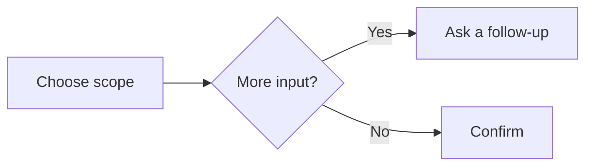

# Local feedback form

## Page JSON

Write one UTF-8 JSON file per page. Set `title`, optional `submit_label`, optional `prologue`, and `fields`. The prologue is a Markdown file path relative to the JSON file. Put both files and any referenced images inside the interaction workspace.

```json
{
  "title": "Plan the first release",
  "prologue": "context.md",
  "submit_label": "Send feedback",
  "fields": [
    {"type": "section", "label": "Scope"},
    {
      "id": "priority", "type": "radio", "label": "What should we prioritise?", "required": true,
      "options": [{"value": "speed", "label": "Early feedback"}, {"value": "coverage", "label": "Broader coverage"}]
    },
    {"id": "confidence", "type": "range", "label": "Confidence", "min": 1, "max": 5, "default": 3, "step": 1},
    {"id": "feedback", "type": "textarea", "label": "What would change your choice?", "max_length": 1200}
  ]
}
```

| Field types | Value returned |
| --- | --- |
| `text`, `textarea`, `email`, `url`, `tel`, `date`, `time`, `datetime-local`, `color` | String. A blank optional field returns an empty string. Use HTTP(S) links for URL answers and native date, time and hex colour formats. |
| `number`, `range` | Number. Blank optional numbers return `null`. A slider always returns a number. |
| `select`, `radio` | Choice value or an empty string. |
| `multiselect`, `checkbox-group` | Array of choice values. |
| `checkbox` | Boolean. Setting `required` requires a checked box. |
| `section` | A heading and optional help text. It adds no answer. |

Use a unique `id` per answer field. Start IDs with a letter and use letters, digits, hyphens and underscores. All fields have a `label`. Use `help`, `placeholder` where the control supports one, `required`, `default` in the return type, and `wide` for a full-width field. Set `min_length` and `max_length` for text, `rows` for textarea, and `min`, `max` and optional browser `step` for number and range. Options are objects with `value` and `label`, and choice values are unique within a field. Pages can have up to 40 fields.

## Prologues

Markdown supports paragraphs, headings, lists, block quotes, emphasis, inline and fenced code, HTTP(S) and mail links, and local raster images. Image paths are relative to the Markdown and stay inside the workspace. Use PNG, JPEG, GIF, WebP or AVIF. Image data on one page is limited to 1 MB. Use angle brackets to wrap destinations with spaces.

A `mermaid` code fence renders basic flowcharts and sequence diagrams without network calls. Flowcharts use `flowchart` or `graph`, a direction such as `TD` or `LR`, named nodes, rectangle or rounded labels, decisions and simple arrows with optional `|labels|`. Sequence diagrams support declared or implicit participants and plain solid or dashed messages. Unsupported diagram syntax is shown as code. [Mermaid flowchart syntax](https://mermaid.js.org/syntax/flowchart.html) · [Mermaid sequence syntax](https://mermaid.js.org/syntax/sequenceDiagram.html)



## Commands

Set `workspace` to a fresh directory beneath an ignored session scratch directory, or to a private temporary directory outside the project when setting up a harness. Resolve `form` from the human-interaction skill you opened. In the install and evolve packages, the script is under `assets/harness/.agents/skills/human-interaction/scripts/` relative to the package root. Use host Python 3.11 or later when a harness environment is unavailable. The examples use this project's paths.

```sh
python=.harness/.venv/bin/python
form=.agents/skills/human-interaction/scripts/form.py
"$python" "$form" serve --workspace "$workspace" --page page-1.json
```

Run `serve` in a background tool session. It prints JSON with a loopback URL. Add `--multi` for an adaptive sequence. The server expires after one hour without a successful submission or a new page. Browser polling leaves that deadline in place. Use `--idle-timeout SECONDS` to change the idle interval or `--lifetime SECONDS` to set an additional hard limit on total runtime. Each option accepts 1–7200 seconds.

An open tab polls for the session state and explains when the session expires. If it misses the final response and cannot reach the server past the last reported deadline, it shows the expiry message using that deadline. The server stops after the browser acknowledges expiry or a short grace period passes.

```sh
"$python" "$form" wait --workspace "$workspace" --page 1 --timeout 20
"$python" "$form" next --workspace "$workspace" --page page-2.json
"$python" "$form" wait --workspace "$workspace" --page 2 --timeout 20
"$python" "$form" close --workspace "$workspace"
```

`wait` exits 0 with the page number, timestamp and answers on stdout, 2 when the wait timed out, and 1 for an error. Saved results can be read again after server shutdown. `next` accepts a page only after the current multi-page submission. Use a separate `close` call to send the final confirmation in multi-page mode. The browser acknowledges the final view and the server exits. If the tab disconnects, the server exits after a short grace period. Use a fresh workspace for each form.
