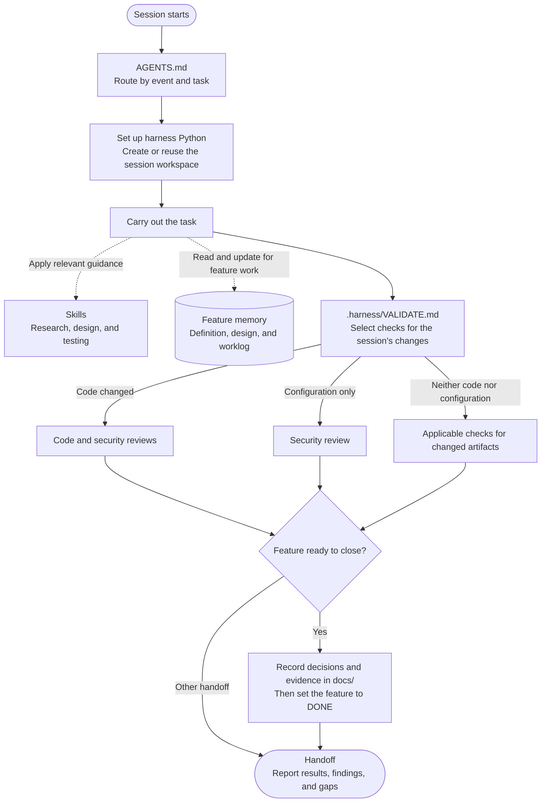

# Ultimate Harness technical design

Ultimate Harness supplies repository-specific instructions and local tools to a coding agent. The agent interprets the current task, decides which rules apply, and invokes checks through its own tools and permissions. The Python scripts implement operations with concrete contracts, such as creating a workspace, advancing a feature phase, or checking a link. This division lets the harness guide judgment while enforcing the invariants it can check directly.

## Repository structure

| Location | Responsibility |
| --- | --- |
| [`AGENTS.md`](../AGENTS.md) | Entry point. Routes session events and kinds of work to the required instructions. |
| [`.harness/agents/`](../.harness/agents/) | Contextual instructions for environment setup, scratch space, and feature memory. |
| [`.harness/references/`](../.harness/references/) | Reusable harness contracts that a target project can install independently. |
| [`.harness/VALIDATE.md`](../.harness/VALIDATE.md) | Index of validation triggers and the decision table for session-end reviews. |
| [`.harness/validation/`](../.harness/validation/) | Specific checks for guidance, scripts, scratch space, code review, and security review. |
| [`.agents/skills/`](../.agents/skills/) | Reusable procedures for harness maintenance, research, skill authoring, software design, and test design. |
| [`.harness/scripts/`](../.harness/scripts/) | Focused Python commands, their dependency manifest, and behavioral tests. |
| `.harness/features/` | Versioned feature definitions, designs, and worklogs. |
| [`scripts/`](../scripts/) | Standalone commands for CI to run in a pull request checkout. |
| [`skills_src/`](../skills_src/) | Conversational installation and evolution skills, with the catalog that selects their reusable assets. |
| `docs/` and [`docs/agents/`](agents/) | Project documentation and durable feature decisions and verification evidence for agents. |
| `.scratch/` | Local notes and experiments. Agents create a workspace per session under `.scratch/agent_sessions/`. |

The project shares instructions, skill sources, scripts, feature records, and documentation through Git. Feature records carry work across sessions and checkouts. Scratch, temporary feature locks and writes, the virtual environment, its setup lock, the default uv cache, and generated skill assets are ignored. [Repository ignore rules](../.gitignore)

## How a session runs



The dotted arrows show what the agent consults during the task. Other validation triggers apply whenever their conditions match.

1. **Initialize the environment.** The session-start rule calls `init_venv.py` with host Python 3.11 or later. The script serializes setup with `.harness/.venv.lock` and creates or reuses `.harness/.venv/`. It prefers uv when available. Without uv, it attempts the standard-library `venv` module and then `virtualenv` if that attempt fails. Setup checks that the interpreter belongs to the harness environment and that system site packages are disabled. It installs the manifest into that environment with implicit installer configuration disabled. uv uses the project-local cache by default and honors an explicit `UV_CACHE_DIR`. Subsequent harness commands use `.harness/.venv/bin/python`. [Environment instructions](../.harness/agents/python-environment.md) · [Bootstrap implementation](../.harness/scripts/init_venv.py) · [Dependency manifest](../.harness/scripts/requirements.txt)
2. **Open a scratch workspace.** A new session calls `create_agent_session.py`. The script creates a private directory with a UTC timestamp prefix and a unique suffix, then prints its absolute path. A resumed session reuses its known directory. Scratch persists after handoff so the agent and the human can inspect local artifacts or continue an experiment. [Scratch instructions](../.harness/agents/scratch-space.md) · [Workspace implementation](../.harness/scripts/create_agent_session.py)
3. **Load the context for the work.** For feature work, the agent reads the relevant feature record and the validation index. When the task calls for harness maintenance, software design, or automated test design, the root instructions route the agent to the corresponding skill. Other skills can be selected for the task. [Agent entry point](../AGENTS.md) · [Feature memory instructions](../.harness/agents/feature-memory.md)
4. **Validate and hand off.** The agent selects checks based on the work and its lifecycle event, runs them with the appropriate environment, and reports what happened. When feature memory applies, the worklog carries forward the important decisions, evidence, and blockers. When the feature is ready to close, the agent records those decisions and evidence in tracked documentation before marking it done. [Validation index](../.harness/VALIDATE.md)

## Feature memory

Feature records preserve enough state for another session to understand the purpose of the work, the current design, and what remains. Each directory follows `YYYY-MM-DD-<slug>`, with the UTC creation date before a lowercase kebab-case slug. Sorting by name groups records by date and sorts slugs within each day. Each directory contains three authored files.

| File | Contract |
| --- | --- |
| `DEFINITION.toml` | Feature description, documentation references, current phase, and functional and non-functional requirements. Each requirement has a stable ID, description, definition of done, and status. |
| `DESIGN.md` | Design decisions and the technical approach, including how they address the requirements and how the behavior will be verified. |
| `WORKLOG.yaml` | Chronological entries with a UTC timestamp, phase, summary, and details. Entries capture substantive progress, decisions, evidence, and blockers. |

Feature phases advance in order through `RESEARCH → DESIGN → IMPLEMENT → TEST → DONE`. The feature may return to an earlier phase and then advances through the intervening phases again. Requirements advance separately through `TODO → WIP → DONE`. A requirement can become `BLOCKED` from `TODO` or `WIP`. The definition records the reason and the prior state, which is the state the requirement returns to on unblocking. `DONE` is terminal for a requirement. The status command allows the feature to enter `DONE` from `TEST` once every requirement is `DONE`. The agent verifies the definitions of done and the applicable checks before requesting that transition. [Feature memory contract](../.harness/references/feature-memory.md)

`create_feature.py` takes a slug, adds the UTC date, validates the initial definition, and publishes the three files from a staging directory. It prints the path to the new record. Status and worklog commands take the full dated directory name so they can address the same feature on later days. The status commands record the transition reason in the worklog. `append_worklog.py` appends a substantive entry and rejects an exact duplicate. [Feature creation](../.harness/scripts/create_feature.py) · [Feature phase changes](../.harness/scripts/set_feature_status.py) · [Requirement status changes](../.harness/scripts/set_requirement_status.py) · [Worklog updates](../.harness/scripts/append_worklog.py)

The shared command code takes an exclusive lock under `.harness/features/.locks/` for the selected feature. A paired status update saves a pending record containing the new definition, new worklog, and digests of their previous contents. The storage helper uses atomic replacement for each file and clears the pending record after completing both writes. After an interruption, the next feature command validates the pending data and completes the update under the same lock. If a file differs from both its prior and intended contents, recovery reports a conflict and preserves that edit. People editing the files directly coordinate with other writers. [Command coordination](../.harness/scripts/_feature_memory.py) · [Storage and recovery](../.harness/scripts/_feature_store.py)

## How instructions are written

- **Use an event as the heading.** A heading such as `Before handing off or ending a session` gives the agent a condition it can evaluate. The instruction underneath names the action and links to the relevant procedure. The root file stays short because detailed rules load when their conditions apply. [Instruction authoring standard](../.agents/skills/build-harness/references/agents-md.md)
- **Keep each rule in its owning file.** Repository-specific policy belongs in the agent instructions or validation guide. A reusable method belongs in a skill. Design rationale and background belong in explanatory documentation. A skill's YAML `name` and `description` support discovery, and its body describes how to execute the workflow and when to open supporting references. [Harness maintenance guidance](../.agents/skills/build-harness/SKILL.md) · [Skill authoring guidance](../.agents/skills/learn-and-build-skills/references/authoring-and-evaluation.md)
- **State actions, inputs, and evidence directly.** A rule that calls a command identifies when to run it, its working directory or inputs when relevant, and what the result means. Scripts handle repeatable operations. The agent assesses architecture, coverage, and whether a check addresses the actual risk. Tests exercise observable outputs, exit status, and resulting state through the supported interface. [Validation authoring standard](../.agents/skills/build-harness/references/validation.md) · [Behavioral testing guidance](../.agents/skills/automated-test-design/SKILL.md)
- **Keep implementation proportional to the job.** A script has a focused responsibility, a clear entry point, and a visible result. Shared code earns its place by protecting a common contract, as the feature lock and storage helpers do. Software design guidance applies KISS and SOLID where they clarify the required behavior and keep the code readable. [Software design guidance](../.agents/skills/software-design/SKILL.md)

## How validation is selected

At handoff, the agent identifies the changes attributable to the session or requested patch, including staged, unstaged, and untracked changes. It classifies changes by purpose. A settings file is configuration even when its syntax is a programming language. The first matching review row governs both which rule files to open and which checks to run. Other validation triggers, such as harness guidance or scratch-space checks, apply independently when their conditions match. [Session-end review table](../.harness/VALIDATE.md#before-choosing-session-end-reviews)

| Change scope | Selected handoff work |
| --- | --- |
| Code, including scripts and tests, with or without configuration | Code review and security review. |
| Configuration without code | Security review and checks specific to the changed settings and the controls they affect. |
| Prose-only or no code or configuration changes | Applicable checks for the changed artifacts. Both reviews are skipped. |

**Code review** combines available static diagnostics with a review of architecture, complexity, and module organization. The agent checks whether tests protect the changed behavior and runs the complete configured unit suite against the final code. **Security review** follows the effects of the change across trust boundaries, including effective configuration and relevant dependencies. It uses STRIDE to identify threats and uses OWASP guidance where web controls apply. The agent runs applicable project checks, verifies relevant controls, and records unresolved findings and missing evidence. [Code review](../.harness/validation/code-review.md) · [Security review](../.harness/validation/security-review.md)

The local validators cover specific contracts. The Markdown checker checks supported local inline file targets. The guidance review checks anchors and whether a trigger leads to the right instructions and actions. The skill checker verifies required package metadata and instruction content. The harness test suite exercises the scripts in isolated workspaces. An agent-session evaluation checks which guidance the agent actually opens and which commands it runs. [Guidance validation](../.harness/validation/harness-guidance.md) · [Skill checker](../.harness/scripts/check_skill_packages.py) · [Script validation](../.harness/validation/harness-scripts.md)

## Feature completion and merge checks

Before setting a feature to `DONE`, update project docs under `docs/` for any changed shared behavior, interfaces, or architecture. Put the enduring decisions, their rationale, and verification evidence for agents under `docs/agents/`. Record which checks ran and what they established, including any scope left unverified. The definition links readers to those documents. Include the records and docs in the same change. [Feature closeout rule](../.harness/agents/feature-memory.md#before-marking-a-feature-done)

From the checkout, a pull request job can run this command with Python 3.11 or later using only the standard library.

```sh
python3 scripts/check_features_done.py
```

The command locates the checkout relative to the script and reads each feature's `DEFINITION.toml`. It exits zero when every feature and requirement is `DONE`, including a new checkout with an empty feature store. It exits one with diagnostics for unfinished statuses, unreadable or invalid status records, and pending status updates. It checks the recorded completion state. The agent's closeout review supplies the decisions and evaluates the evidence. Each adopting project configures its own CI job to call the command. [Merge check implementation](../scripts/check_features_done.py)

## How the harness evolves

The harness uses the same feature and validation workflow for changes to itself. An improvement starts with an observed problem and a concrete description of the desired behavior. The maintenance workflow traces the problem to its owning instruction, skill, or script and makes a scoped change. Research, prototypes, and raw evaluation results live in scratch. A verified change becomes tracked guidance or code, and the feature record links to the durable decisions and evidence. [Harness maintenance workflow](../.agents/skills/build-harness/SKILL.md)

For unfamiliar tasks, the research workflow starts from the question and checks whether sources actually support their claims. Socratic questioning exposes assumptions, tests alternatives and counterexamples, and checks whether the conclusion transfers to a fresh case. The skill-authoring workflow turns the supported procedure into short instructions with references or scripts where they help. [Research workflow](../.agents/skills/learn-a-topic/SKILL.md) · [Skill authoring workflow](../.agents/skills/learn-and-build-skills/SKILL.md)

Evaluation distinguishes **discovery**, **execution**, and **outcomes**. A rule can point to the correct file while the agent still runs an unrelated check. When evaluating a change, use fresh sessions, keep inputs and runtime comparable, and define success before inspecting the results. Check a matching case, an unrelated case, and an overlap. For a claim of improvement, compare matched runs with the relevant baseline and score what the agent did and what it found. Keep scoring criteria outside the worker's instructions. [Evaluation procedure](../.agents/skills/learn-and-build-skills/references/authoring-and-evaluation.md#evaluate-independently-of-the-draft)

## How portable skills are built

The two skills share an explicit file catalog. Each catalog entry names a capability, its repository-relative files, and its dependencies when copied intact. The builder copies those live files into each skill's generated `assets/harness/` directory, preserving paths and replacing old generated content. Edit portable content at its source. When adding an export, check the file's commands and links and update the catalog for any new dependencies. [Export catalog](../skills_src/harness-files.toml) · [Build command](../scripts/build_harness_skills.py)

The adopting project supplies its own entry point, validation index, ignore rules, documentation, and CI configuration. The catalog excludes this repository's versions of those files, its feature records, scratch, and runtime state. It includes the standalone feature merge check as an optional component.

GitHub Actions builds from the checkout, validates both packages, and publishes a `.tar.gz` for each skill in the `harness-skills` artifact. The archives preserve hidden harness directories and file permissions. This workflow belongs to the source repository. [Packaging workflow](../.github/workflows/build-harness-skills.yml) · [GitHub Actions artifact docs](https://docs.github.com/en/actions/concepts/workflows-and-actions/workflow-artifacts)

The optional `copilot-review` component gives Copilot PR reviews an entry point into the shared review rules. It uses the validation index to select checks and grounds findings in evidence for the reviewed commit. [Reviewer instructions](../.github/instructions/harness-review.instructions.md)
